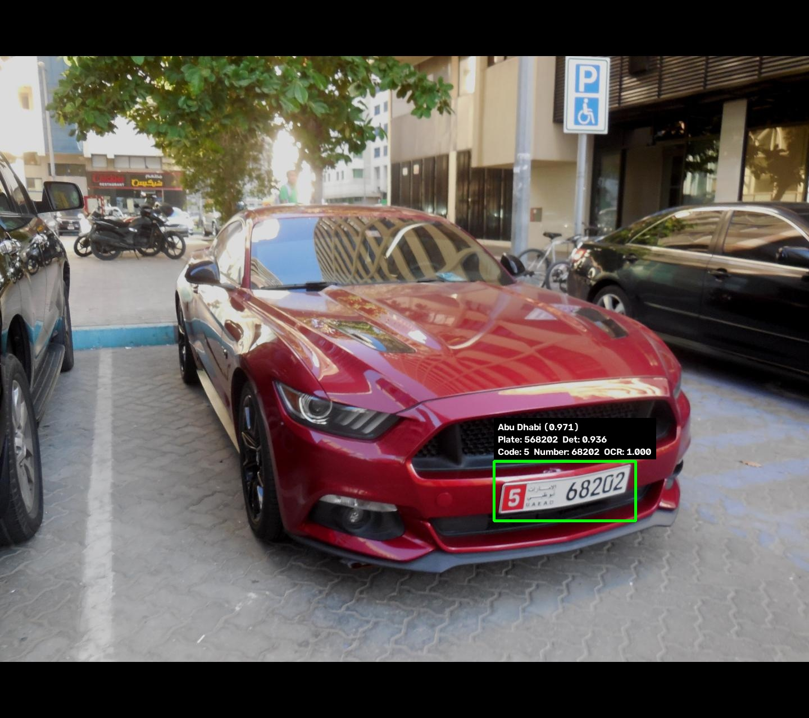
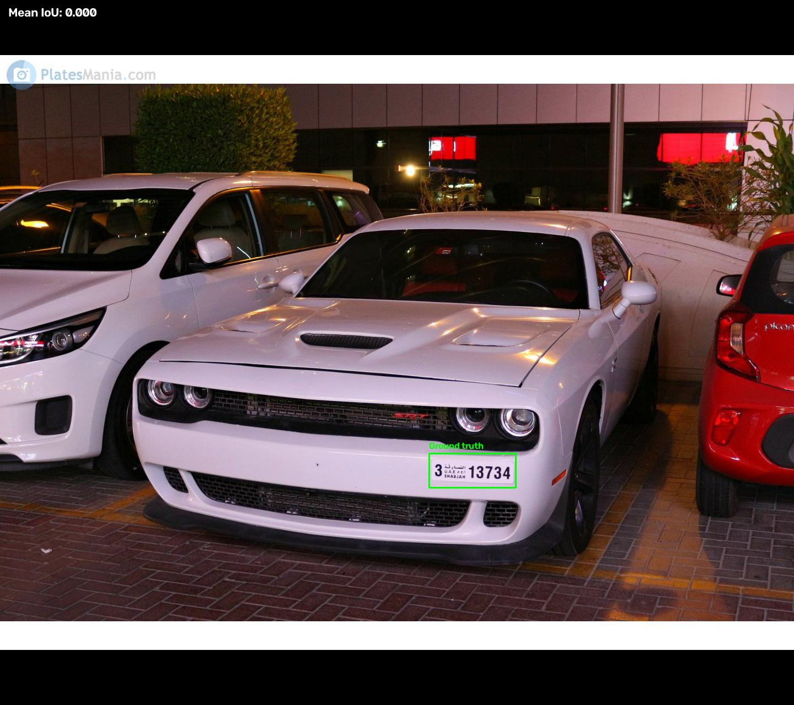
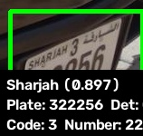

# UAE License Plate Recognition

This computer vision pipeline detects UAE license plates in vehicle photos, reads the plate text, and classifies the plate design across all seven emirates. It saves an annotated image, plate crops, and structured JSON with the plate code and registration number.

[Run the demo](https://github.com/azimaus970/UAE-Plate-Recognition/blob/main/recognition/README.md#run-the-demo) · [Preprocessing guide](https://github.com/azimaus970/UAE-Plate-Recognition/blob/main/PREPROCESSING.md)

## Demo

| Successful recognition | Missed detection |
| --- | --- |
|  |  |
| The pipeline read the Abu Dhabi plate, classified its emirate, and parsed its numeric code. | RF-DETR missed a visible plate at night. The green box marks the ground-truth annotation. |

Selected fields from the successful run's JSON output.

```json
{
  "combined_plate_text": "568202",
  "code": "5",
  "number": "68202",
  "emirate": "Abu Dhabi",
  "format_valid": true
}
```

[Full JSON output](https://github.com/azimaus970/UAE-Plate-Recognition/blob/main/recognition/results/examples/final_pipeline/5-68202_jpg.rf.oZKhAsMGTwCx7U4INtkE/result.json) · [Detector example notes](https://github.com/azimaus970/UAE-Plate-Recognition/blob/main/recognition/results/examples/rfdetr/example_notes.csv)

<details>
<summary>See a separate run on a cropped Sharjah plate</summary>



[Crop-run JSON](https://github.com/azimaus970/UAE-Plate-Recognition/blob/main/recognition/results/examples/final_pipeline/3-28256_jpg.rf.hg4iTJTjW9tD9DIoj3Dq__plate01/result.json)

</details>

## How it works

1. **Detect and crop.** RF-DETR Medium finds the plate. The pipeline pads each side by 8% of the box width or height before cropping.
2. **Read and classify.** OCR v2 reads the crop, and a seven-class ResNet18 predicts the emirate from the same crop.
3. **Parse and export.** Rules derived from training data split the OCR string into a code and number using the predicted emirate. The script saves the annotated image, crops, and JSON.

## Results

Three detectors were evaluated on the same frozen **1,432-image test split**.

| Model | mAP@50:95 | mAP@50 |
| --- | ---: | ---: |
| RF-DETR Medium | **0.8664** | **0.9965** |
| RT-DETR-L | 0.8639 | 0.9944 |
| YOLOv8n | 0.8607 | 0.9949 |

In the RF-DETR augmentation ablation, mAP@50:95 was nearly unchanged (0.8664 with augmentation, 0.8666 without). Augmentation improved mAP at both IoU 0.50 and 0.75.

| Stage | Evaluation set | Result |
| --- | --- | ---: |
| OCR v2 | 1,017 original test crops | **98.23%** exact plate match |
| OCR v2 | 173 numeric-prefix Abu Dhabi test crops | **86.13%** exact plate match |
| Emirate classification | 1,466 test crops | **98.54%** macro F1 · 99.59% accuracy |

These scores measure individual stages. The full-pipeline examples are qualitative. The numeric-prefix subset was harder for OCR, and the detector gallery includes missed plates at night. Evaluating recall by lighting condition and exact plate matches on detector-generated crops would help quantify those errors. [OCR failure examples](https://github.com/azimaus970/UAE-Plate-Recognition/blob/main/recognition/results/figures/ocr/ocr_uae_v2_abu_dhabi_test-incorrect_examples.jpg) · [Evaluation details](https://github.com/azimaus970/UAE-Plate-Recognition/blob/main/recognition/README.md#main-results)

## Run on one image

Install the recognition environment and place the three model checkpoints, OCR YAML, and parser rules as described in the [demo setup](https://github.com/azimaus970/UAE-Plate-Recognition/blob/main/recognition/README.md#run-the-demo). The recognition environment was recorded with Python 3.13.14 and PyTorch 2.11.0 for CUDA 12.8. [Environment details](https://github.com/azimaus970/UAE-Plate-Recognition/blob/main/recognition/ENVIRONMENT.txt)

Start in the repository root in PowerShell with the recognition environment active.

```powershell
cd recognition
python scripts/run_final_uae_plate_pipeline_v2.py --image 'C:\path\to\vehicle.jpg'
```

The script writes `annotated.jpg`, `crops/`, and `result.json` under `recognition/results/final_pipeline_demo_v2/<image-stem>/`. The committed examples can be browsed directly. [Demo outputs](https://github.com/azimaus970/UAE-Plate-Recognition/tree/main/recognition/results/examples/final_pipeline)

## Dataset and preprocessing

The detector dataset contains **9,610 images** and **12,451 plate boxes** across frozen train, validation, and test splits. GitHub contains the YOLO labels, COCO annotations, manifests, preprocessing notebook, validation reports, recognition code, and selected results. The full image dataset and model artifacts are distributed separately.

| Split | Images | Plate boxes |
| --- | ---: | ---: |
| Train | 6,738 | 9,415 |
| Validation | 1,440 | 1,525 |
| Test | 1,432 | 1,511 |

[Preprocessing and validation](https://github.com/azimaus970/UAE-Plate-Recognition/blob/main/PREPROCESSING.md) · [Dataset attribution](https://github.com/azimaus970/UAE-Plate-Recognition/blob/main/DATASET_ATTRIBUTION.md) · [Recognition guide and credits](https://github.com/azimaus970/UAE-Plate-Recognition/blob/main/recognition/README.md)
